# Homunculus

**One picture in, a rigged and animated 3D character out. Fully local, on one 24 GB GPU.**

Give Homunculus a picture of a character (or a turnaround sheet, or an existing 3D model) and it builds a textured 3D model, rigs it with a 52-bone Mixamo skeleton (fingers included) and animates it: copy a dance straight from a video (one dancer, or a whole group from one shot, put on several characters, even ready-made game characters), label the hands, describe a motion in plain words, or bring Mixamo and mocap clips. A local web app runs the pipeline, shows every step, and lets you (or local vision-language models, or nobody at all) decide at each gate. Current version: **v2.0** ([tags](https://github.com/So-bonkers/Homunculus/tags)).

## Showcase: *Miles Jackson*

https://github.com/user-attachments/assets/a6c291a1-b4cb-4171-97e5-f90ad6a3fa6d

*A Miles Morales character built by a Homunculus run from one picture, exported with the run's Mixamo zip, animated with Mixamo's Thriller clips, joined and rendered with a moving camera by `tools/join_clips.py` and `tools/render_dance.py`, then cut to music. The video is 2 minutes, with sound ([docs/media/miles_jackson.mp4](docs/media/miles_jackson.mp4)).*

## Showcase: a group dance from one video

[]

*"We Dem Boyz" (a master-class video, 1:50 of it, one fixed camera, six dancers in different clothes) on the left; the six dancers followed through the whole shot, their motion read by GVHMR, put in one scene with the video's own camera and floor, and retargeted onto six handmade community characters (the Valorant agents Yoru, Tejo, Iso, Neon, Killjoy and Viper), with the hands set from labels, on a neon stage.  The sound is the video's.  How: [docs/GROUP_DANCE.md](docs/GROUP_DANCE.md) and [docs/READY_MADE_CHARACTERS.md](docs/READY_MADE_CHARACTERS.md).

## How it works

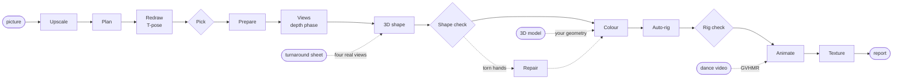

Diamonds are review gates: three local judges, you, or nobody (`--no-llm`).

| stage | what happens | model / tool |
|---|---|---|
| Upscale | 4× upscale with the model that fits the picture's style (photo, anime, 3D render) | RealESRGAN, 4x-UltraSharp |
| Plan | a vision-language model describes the character and writes the redraw prompt | Qwen3.8-VL 27B |
| Redraw, Pick | the character redrawn as a clean full-body T-pose with open hands, several candidates, one picked | Qwen-Image 2.1 Turbo |
| Prepare | clean-up and upscale of the chosen redraw; optional face close-up at full resolution | RealESRGAN, Qwen-Image 2.1 Turbo |
| **Views** (depth phase) | single-picture runs: a quick proxy shape, its depth map from behind, and the character's back drawn under that depth map; kept only if its outline matches the proxy, so the shape model sees two views that agree | Pixal3D, Qwen-Image 2.1 Turbo + depth ControlNet |
| 3D shape, Shape check | shape candidates from the front (and back) view, a silhouette carve, a check (judges, you, or none) | Pixal3D (multiview) |
| Colour | the picture projected onto the mesh, so the rig is built and checked on a coloured model; on sheet runs, surfaces no view sees are filled from their painted neighbours | Blender |
| Auto-rig, Rig check | 52-bone Mixamo skeleton with skin weights; pose tests, wrist-bend check | Make-It-Animatable |
| Animate | **the dance in a video** (default) and/or **text prompts**; finger poses from a pose library | GVHMR, UniMate |
| Texture | face fit from your own picture, the finished texture put on the rig and on every clip | Blender |

## Features

**Ways in**
- **One picture**: any style (photo, anime, 3D render). *Use my picture as is* skips the redraw; *Looks* restyles it (3D film, Game, Anime 3D, Clay, Chibi), or makes one candidate per look for you to pick.
- **A turnaround sheet** (`--sheet`): one picture with the character four times (front, left, back, right). The shape is built from all four views with the multiview Pixal3D, and the four real pictures become the texture, so the back and sides are real instead of guessed. Optional pictures from above and below (`--sheet-top`, `--sheet-bottom`) for the top of the head and the soles. [docs/TURNAROUND.md](docs/TURNAROUND.md)
- **A 3D model** (STL, OBJ, PLY, GLB, FBX): oriented, painted from its own renders and rigged; a model that is not in a T-pose is put into one first (SkinTokens + a Blender bake).

**Making the model right**
- **Depth phase before the shape:** the back of a single-picture character is drawn under the depth map of a proxy shape and checked against its outline, so Pixal3D does not have to guess it. [docs/DEPTH_VIEWS.md](docs/DEPTH_VIEWS.md)
- **Repair any part:** paint over what came out wrong (fused fingers, a crumpled helmet top, a melted foot), say what it is, choose the redraw you like; the part is rebuilt with Pixal3D and grafted in with a clean planar cut, every loop at the seam bridged. Torn hands found by the geometric hand check are repaired automatically before rigging (`--auto-repair auto|alert|off`). [docs/REPAIR.md](docs/REPAIR.md)
- **Retexture a part:** brush an area, then describe it or give a reference picture; it is projected onto the model, the rig and every clip. [docs/RETEXTURE.md](docs/RETEXTURE.md)
- **Your own face:** the face texture comes from your picture (upscaled and fitted by landmarks), not from the redraw.

**Animation**
- **Dance from a video** (the default source): one person dancing, a steady or moving camera. GVHMR reads the body motion, the camera's own motion is tracked from the background and taken out, and the dance is retargeted onto your rig, with a preview and a side-by-side with the video. In the app: the **Animate** page (`/ui#/animate`: any finished character + a new video, no new run: the job shows its stages with a report each, the time left, then the video and your character playing together), or a run's Animate tab; on the command line: `--anim-video clip.mp4 --anim-from 30 --anim-to 50`. [docs/VIDEO_MOTION.md](docs/VIDEO_MOTION.md)
- **A group from one video:** a fixed-camera shot with several dancers (tested with six in different clothes): everybody is followed by what they wear, the body of each read by GVHMR, all of them put in one scene with the video's own camera and floor, and rendered together next to the video. A video with camera cuts gets one floor and camera per shot. [docs/GROUP_DANCE.md](docs/GROUP_DANCE.md)
- **Hand labels for a dance:** a timeline editor for the fingers, wrist and palm of any clip (a pose library of 48 shapes, 15 wrists and 7 palms, 83 hip hop hand moves and a vocabulary of 105 full-body moves, mostly breaking, each with a picture); a vision-language model (Qwen3.8) can draft the labels from the dancer's video, a chunk at a time, landing in the editor as they finish. On our test clips its labels agree with a person's about 30-42% of the time, so treat them as a draft. [docs/VIDEO_MOTION.md](docs/VIDEO_MOTION.md)
- **Ready-made characters:** handmade rigged models (the community Valorant agents) are rebuilt on the same 52-bone skeleton in about a minute (`tools/import_rigged.py`), so every clip, hand label and render works on them. [docs/READY_MADE_CHARACTERS.md](docs/READY_MADE_CHARACTERS.md)
- **Text to animation** with UniMate: type a motion ("walks forward") or pick from a library of 190 prompts in 10 categories, each with a 3D preview.
- **Fingers** set from a pose library matched to the motion (fist for a punch, grip for a sword, open for a wave), or from your own hand labels (above).
- **Mixamo and mocap:** a Mixamo zip export, and tools to join Mixamo clips, retarget BVH mocap (CMU) and SMPL dance datasets (AIST++, FineDance) onto any rig, and render a clip to MP4 with a moving camera (see *Tools* below).

**Running it**
- **One local web app** at http://127.0.0.1:8765/ui: start runs, watch every stage live, review, view the model in 3D (textured, rigged, clay, wireframe, bones), repair, retexture, animate, export.
- **Who decides:** three local judges (Qwen3.8, Gemma 4, Qwen3.6), you (*Override*: a window to overrule them; *Manual*: you are the judge), or nobody: `--no-llm` runs without any language model and accepts what is built, for you to judge.
- **Fork** any stopped run from any stage with new instructions or settings; the original stays untouched.
- **Safe on one GPU:** one GPU job at a time (a lock), a VRAM watchdog, every other model unloaded before a heavy stage.
- **Resumable and notified:** every stage is checkpointed; desktop notifications say when a run needs you or why it stopped.
- **Accept and export:** GLB while you work; FBX, USD, OBJ and STL on *Accept*, plus a package zip with the rig, textures and every clip.
- **System check:** the *Check* button (`python -m homunculus.doctor`) tests every service, model and package and says how to fix what is missing.

## How long it takes

Single measurements on the machine below, not averages.

| run | time | stage by stage |
|---|---|---|
| **Single picture**, depth phase, `--no-llm` (an F1 driver, 2026-10-13) | **21 min** | views 3 min 4 s (back view kept, outline IoU 0.88) · 3D shape 15 min 44 s (3 candidates from front + back) · colour 24 s · rig 71 s · texture 27 s |
| **Turnaround sheet** (the same driver, 2026-10-13) | **17 min** | 3D shape 11 min 5 s · colour 54 s · rig 3 min · texture 9 s |
| **Dance from a video**, a 10 s slice of a freestyle video with a moving, zooming camera | **2 min 19 s** | GVHMR + camera tracking + retarget about 80 s, then the preview render |
| A Turbo redraw (576×1024) | **6 s** | after a one-time load of about 25 s |

The oldest full measurement (2026-10-07: a knight from one picture, the 30-step image model, three judges with 60 s review windows, 5 text prompts × 2 takes, the old texture views) took 52 min 47 s. Judges and review windows add minutes per gate; the 3D shape stage varies the most.

## Quick start

```bash
git clone https://github.com/So-bonkers/Homunculus && cd Homunculus
./setup.sh app             # then the models and services: see Setup
./launch.sh                # starts the app and opens http://127.0.0.1:8765
```

Drop a picture on the home page and press **Start run**. From a terminal:

```bash
# a picture, animated with the dance from 0:30 to 0:50 of a video
.venv/bin/python -m homunculus.orchestrate ~/Downloads/hero.png --name hero \
    --anim-video ~/Downloads/dance.mp4 --anim-from 30 --anim-to 50

# a turnaround sheet, no language model anywhere, you judge the result
.venv/bin/python -m homunculus.orchestrate ~/Downloads/sheet.png --name hero_sheet --sheet --no-llm --face off

# text-prompt animation instead
.venv/bin/python -m homunculus.orchestrate ~/Downloads/hero.png --name hero2 --anim "walks forward" --anim "jumps in place"
```

Output: `runs/<name>/07_rig/<name>_final.glb` (FBX on Accept), clips in `runs/<name>/09_animate/clips/`, `contact_sheet.png` and `report.md`. Close other GPU-heavy applications first.

### Handy options

| you want to… | add |
|---|---|
| continue after a crash or reboot | the same command again (finished stages are skipped) |
| redo from a stage | `--from mesh` (stages: `ingest upscale plan edit pick upscale_edit views mesh mesh_check color rig rig_check animate texture report`) |
| redo one stage | `--only rig` |
| judge everything yourself | `--review manual` (`override` gives you a window to overrule the judges, `off` lets them decide) |
| run without any language model | `--no-llm` (set `--face on` or `off` yourself: nothing decides it) |
| skip the depth phase | `--depth-views off` |
| keep the picture's own style, no redraw | `--direct` |
| restyle the character | `--look stylized\|game\|anime3d\|clay\|chibi` (`choose` = one candidate per look, you pick) |
| a turnaround sheet with top and bottom pictures | `--sheet --sheet-top top.png --sheet-bottom bottom.png` |
| a bare torso (avoids sleeve cuffs tearing at the wrists) | `--outfit shirtless` |
| a zip for Mixamo's free auto-rigger and animations | `--zip` → `exports/mixamo_<name>.zip` |

## Tools

Stand-alone scripts in `tools/`, used by the pipeline or on their own:

| tool | what it does |
|---|---|
| `retarget_bvh.py` | retarget a BVH (CMU mocap, SMPL datasets) or a Mixamo-rigged FBX/GLB animation onto any Mixamo-skeleton character, with a sanity report (hip height, foot slide) |
| `smpl_to_bvh.py` | AIST++ (`.pkl`), FineDance (`.npy`) and GVHMR (`.npz`) SMPL motion to BVH |
| `video_to_smpl.py`, `track_camera.py`, `compensate_camera.py` | video → SMPL motion with GVHMR, and the camera's own motion taken out |
| `join_clips.py` | Mixamo clips on one character, as single clips and one joined clip (GLB + FBX) |
| `render_dance.py`, `make_mp4.py` | render an animated character to MP4 with a moving camera (or `--fixed`), Blender in parallel |
| `track_raw.py`, `group_tracks.py`, `group_segments.py`, `gvhmr_segments.py`, `group_crops.py` | a group in one shot: track everyone, stitch the ids into dancers by what they wear, cut each dancer's verified stretches, GVHMR on every stretch, a 4K crop per dancer |
| `group_scene.py`, `register_group.py`, `render_group.py`, `group_audit.py` | the dancers in one scene (the camera's floor and height, one set per shot when the video cuts), clips registered in the app, the group rendered together (Workbench, or `--neon`, or `--over-plate` onto the video's own room), a check for dancers the verification dropped |
| `multi_track.py`, `extract_tracks.py`, `cast_clips.py` | every person of a shot, one clip each (fragments of one person re-linked across short gaps), then put on different characters in turn |
| `import_rigged.py`, `convert_rigged.py`, `skin_from_donor.py` | a ready-made rigged model rebuilt as the app's 52-bone character; skin weights copied from a donor onto a mesh that has no rig |
| `clean_plate.py` | a video with the people painted out (the room, to put rendered characters into) |
| `annotate_clips.py` | label the hands of several clips with the vision-language model, one after another |
| `depth_guided_views.py` | the depth-guided view experiments behind the depth phase |

## The app

Open **http://127.0.0.1:8765/ui** (the classic interface is still at http://127.0.0.1:8765/). A dark studio layout in React: every run live, the pipeline as a rail of 15 stages, a review panel when a gate needs you, a 3D viewer, Repair and Retexture brushes, a command palette (<kbd>Ctrl</kbd>+<kbd>K</kbd>), and a 21-step guided tour (the compass in the top bar; offered on the first visit).

| | |
|---|---|
| 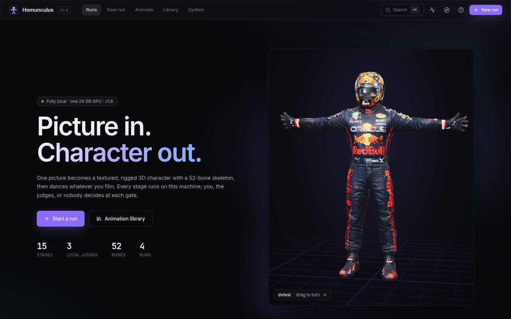 **Home**: a live 3D turntable of your latest character | 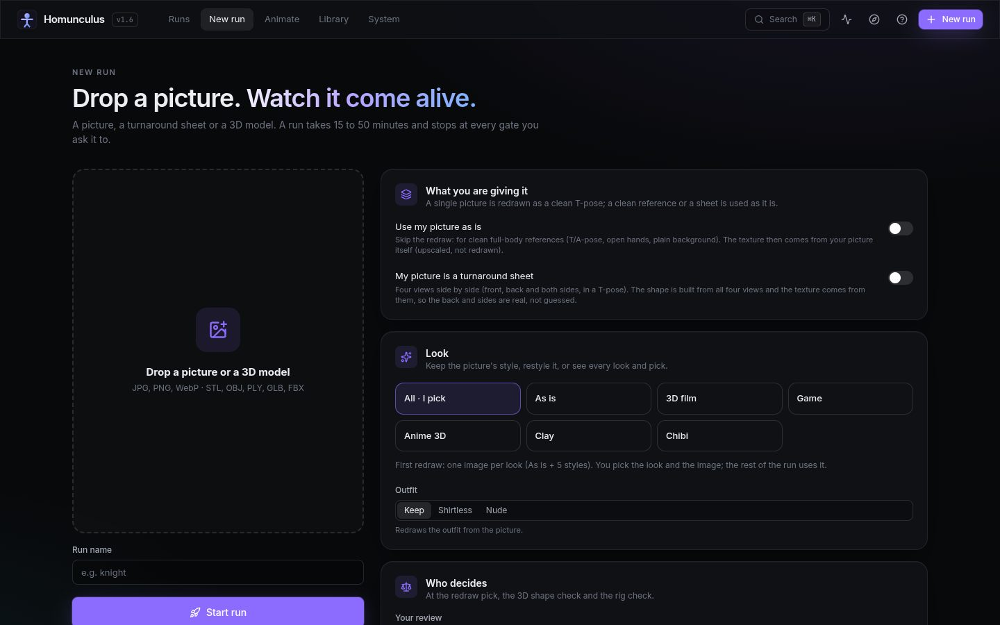 **New run**: every option in one form |
| 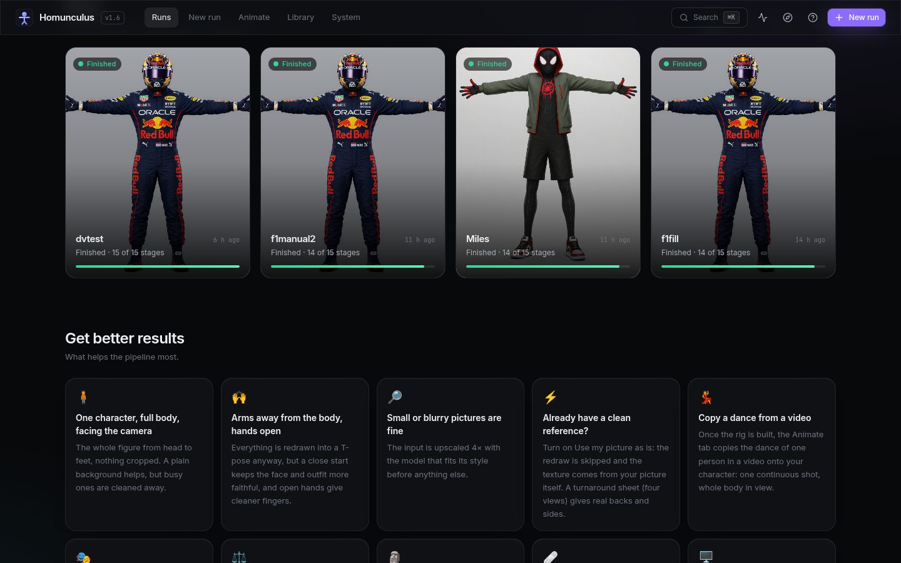 **Runs** with live status, Fork and Delete, and tips | 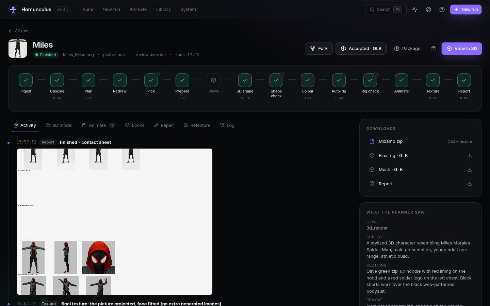 **A run**: the pipeline, the story so far, downloads |
| 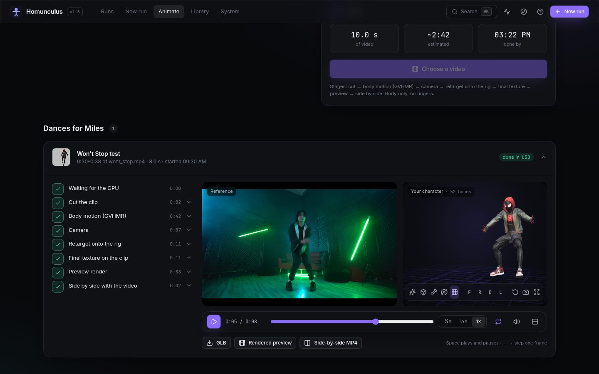 **Animate**: pick a finished character and a video; the job's stages, reports and time left, then the video and the character playing together | 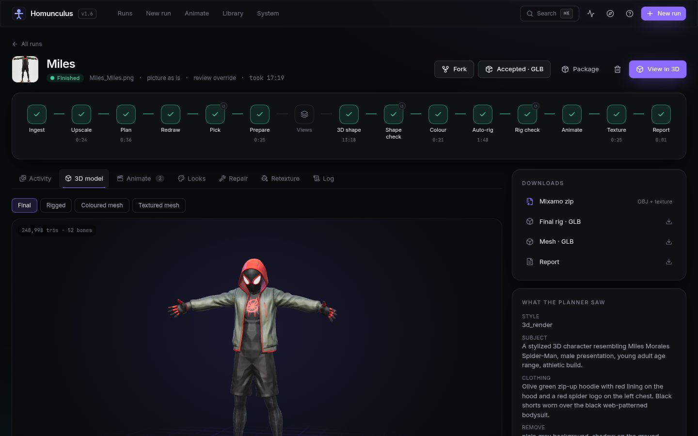 **3D model**: final, rigged, clay, wireframe, bones |

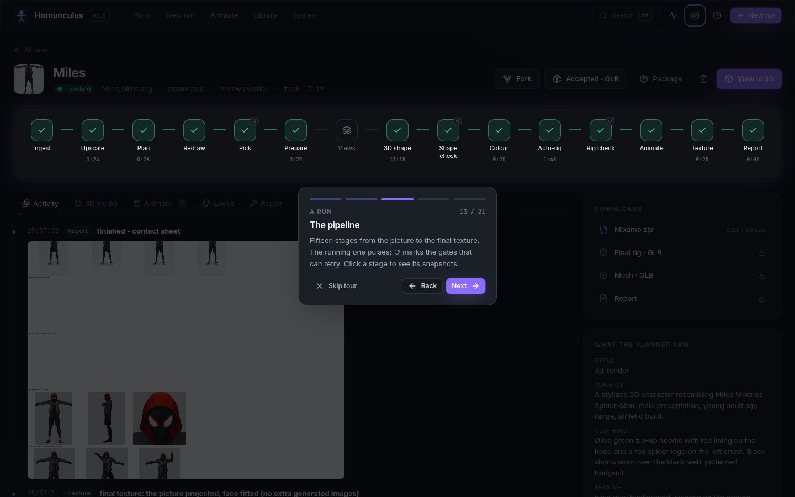

<details>
<summary>Snapshots of the stages, from one run</summary>

| stage | snapshot |
|---|---|
| Upscale | 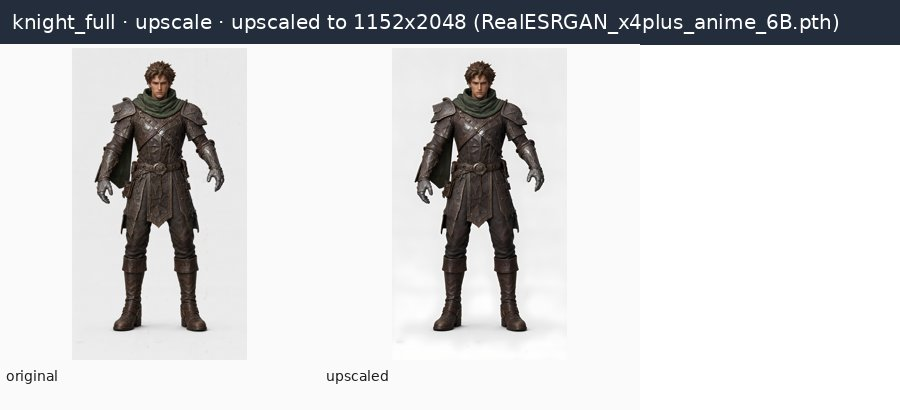 |
| Plan | 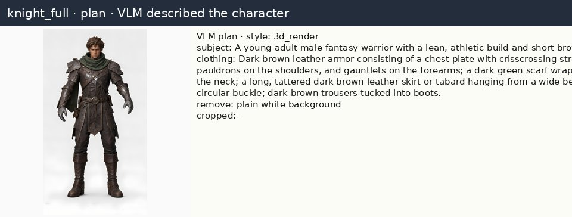 |
| Redraw + pick | 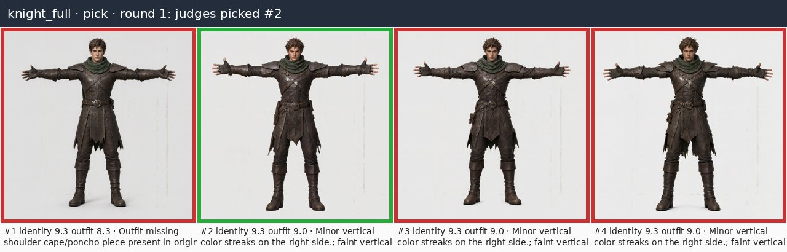 |
| Face close-up | 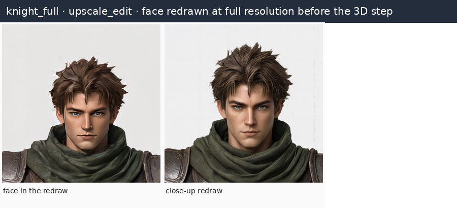 |
| 3D shape check | 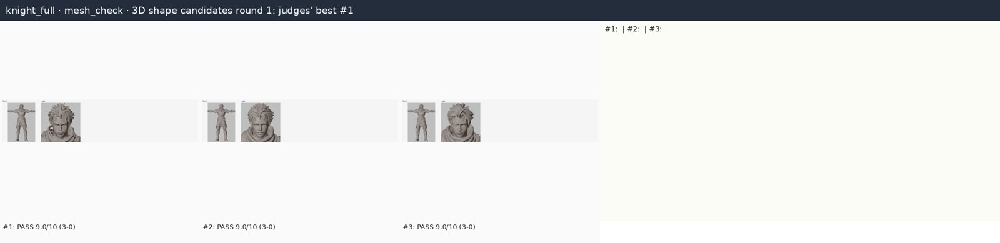 |
| Quick colour | 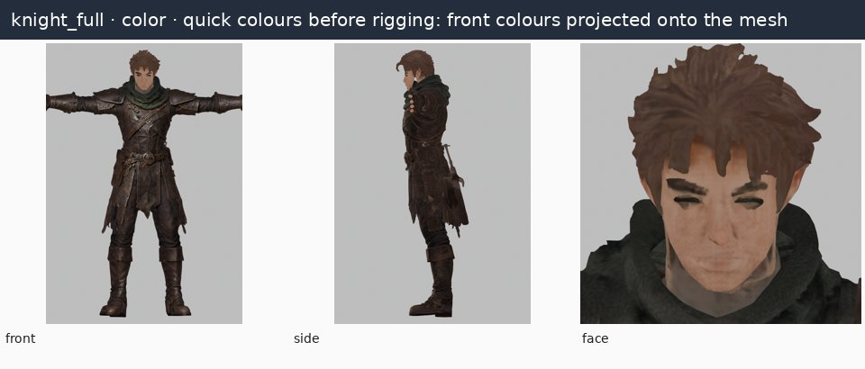 |
| Rig check | 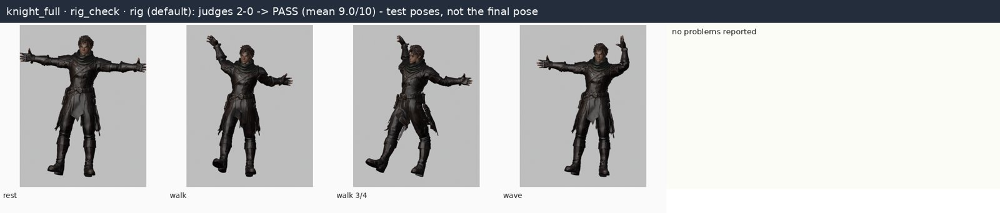 |
| Animate | 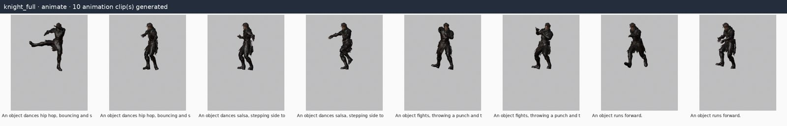 |
| Final texture | 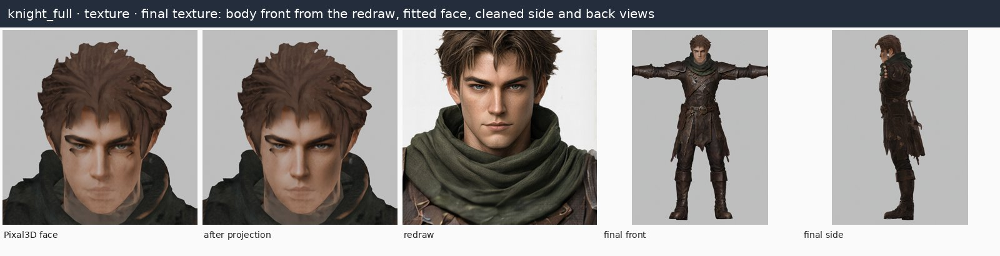 |

</details>

<details>
<summary>Text-to-animation samples (UniMate)</summary>

| prompt | male | female |
|---|---|---|
| walks forward | 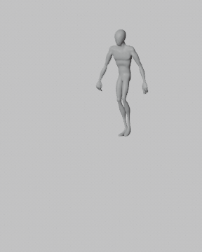 | 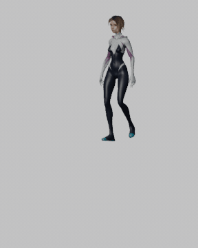 |
| does a spinning kick | 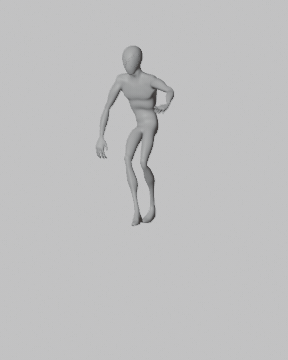 | 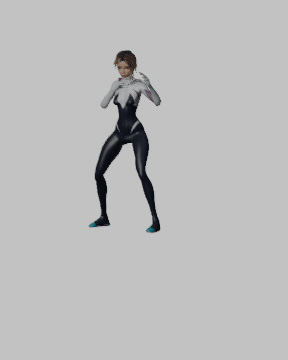 |
| dances hip hop | 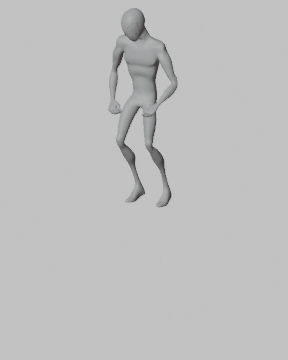 | 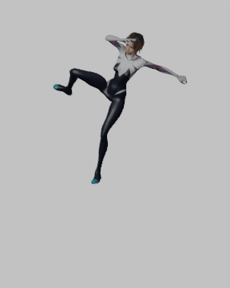 |
| dances salsa | 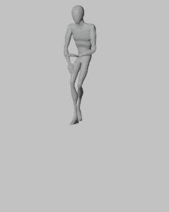 | 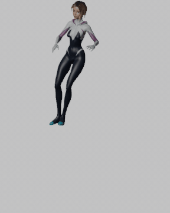 |
| slashes forward with a sword | 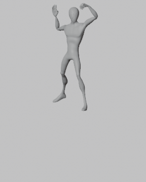 | 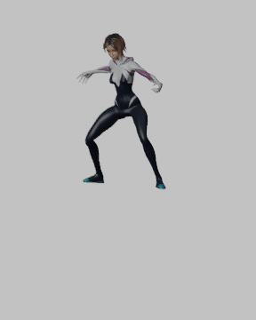 |
| jumps forward | 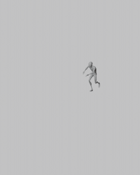 | 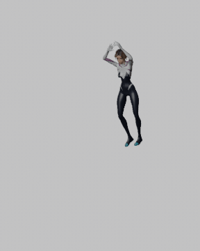 |

UniMate is an early research model: walking, running and simple gestures are good; acrobatics and props are hit and miss. Clips are 1.6 s at 30 fps.

</details>

## Hardware it was built and tested on

| | |
|---|---|
| GPU | AMD Radeon RX 7900 XTX class (Navi 31), **24 GB VRAM**, ROCm 7.2, PyTorch 2.14 |
| CPU / RAM | AMD Ryzen 9 5950X (16 cores) / 60 GB |
| OS | Ubuntu 26.04 LTS (Linux 7.0), Blender 5.2 |
| Budget | the pipeline stays under **22.5 GB VRAM**, one heavy model at a time, with the desktop on the same GPU |

Only tested on this machine. NVIDIA should work for the PyTorch parts (the VRAM probe reads `/sys/class/drm` and would need adapting) but is untested.

## Setup

Homunculus orchestrates other projects, so setup is mostly installing and downloading them. `./setup.sh [all|app|comfy|mia|unimate|skintokens]` scripts what it can; it was written on the author's machine and **has not been run from a clean install**, so treat it as a checklist.

**You need:** Linux, a 24 GB GPU, about **215 GB** of free disk (measured here: ComfyUI's models 57 GB, the rigger 30 GB, GVHMR 25 GB, UniMate 21 GB, Python environments 17 GB, the Studio models about 65 GB), [uv](https://docs.astral.sh/uv/), git, ffmpeg, [Blender](https://www.blender.org/download/) on your `PATH` (tested with 5.2), the [Hugging Face CLI](https://huggingface.co/docs/huggingface_hub/guides/cli) and [Unsloth Studio](https://unsloth.ai/docs/new/studio). Node.js only to rebuild the web interface or the preset previews.

1. **The app:** `./setup.sh app`
2. **Unsloth Studio** serves the planner and the judges (and the fallback image model) on `127.0.0.1:8888`: `unsloth studio --api-only -H 127.0.0.1 -p 8888`, ideally as the user service `unsloth-api`. Models load by name the first time they are needed. Not needed for `--no-llm` runs.
3. **ComfyUI, Pixal3D, the upscalers and Qwen-Image 2.1 Turbo:** `./setup.sh comfy` (the Doctor lists any model file that is missing)
4. **Make-It-Animatable:** `./setup.sh mia`
5. **UniMate:** `./setup.sh unimate`, then UniMate's requirements into `unimate/.venv`
6. **Dance from video (GVHMR):** its own environment in `gvhmr/`, plus the SMPL and SMPL-X body models (free, non-commercial registration): step by step in [docs/VIDEO_MOTION.md](docs/VIDEO_MOTION.md)
7. **SkinTokens** (optional, only for 3D models not in a T-pose): `./setup.sh skintokens`, then build it with CMake
8. `./launch.sh`, drop a picture, **Start run**.

### Every model and where to get it

| role | model | licence | link |
|---|---|---|---|
| Every redraw (redraw, close-ups, Repair, Retexture, the depth phase) | **Qwen-Image 2.1** in ComfyUI: `qwen_image_2.1_int8_convrot` (7.3 GB), the text encoder `qwen3vl_8b_int8_convrot` (9.4 GB), the VAE, the **turbo LoRA** `qwen_image_2.1_turbo_lora_avg_rank_178_bf16` (0.9 GB, 8 steps) and the **Fun ControlNet Union** `qwen_image_2.1_fun_controlnet_union_int8_convrot` (3.8 GB, the depth phase); about 22 GB | Qwen Research | [Comfy-Org/Qwen-Image-2.1](https://huggingface.co/Comfy-Org/Qwen-Image-2.1) |
| Fallback image model | **Qwen-Image 2.1 edit** `qwen-image-2.1-F16.gguf` via Unsloth Studio (30 steps; `HOMUNCULUS_IMAGE_TURBO=0` uses it everywhere) | Qwen Research | [unsloth/Qwen-Image-2.1-GGUF](https://huggingface.co/unsloth/Qwen-Image-2.1-GGUF) |
| Planner + judge 1 | **Qwen3.8 27B** vision (`UD-Q4_K_M` + `mmproj-F16`) | Apache-2.0 | [unsloth/Qwen3.8-27B-GGUF](https://huggingface.co/unsloth/Qwen3.8-27B-GGUF) |
| Judge 2 | **Gemma 4 26B-A4B** QAT (`UD-Q4_K_XL` + `mmproj-F16`) | Apache-2.0 | [unsloth/gemma-4-26B-A4B-it-qat-GGUF](https://huggingface.co/unsloth/gemma-4-26B-A4B-it-qat-GGUF) |
| Judge 3 | **Qwen3.6 35B-A3B** MTP (`UD-IQ4_NL` + `mmproj-F16`) | Apache-2.0 | [unsloth/Qwen3.6-35B-A3B-MTP-GGUF](https://huggingface.co/unsloth/Qwen3.6-35B-A3B-MTP-GGUF) |
| Picture → 3D shape | **Pixal3D** (`pixal3d_bf16`, `pixal3d_multiview_bf16` or its int8 variant) + DINOv3 + two TRELLIS-2 VAEs, in ComfyUI | MIT | [Comfy-Org/Pixal3D](https://huggingface.co/Comfy-Org/Pixal3D) · [ComfyUI](https://github.com/comfyanonymous/ComfyUI) |
| Upscalers | **RealESRGAN x4plus**, **x4plus anime 6B**, **4x-UltraSharp** | BSD-3 / BSD-3 / CC BY-NC-SA 4.0 | [Real-ESRGAN](https://github.com/xinntao/Real-ESRGAN) · [UltraSharp](https://huggingface.co/Kim2091/UltraSharp) |
| Auto-rig | **Make-It-Animatable** + Mixamo template data | Apache-2.0 | [jasongzy/Make-It-Animatable](https://huggingface.co/jasongzy/Make-It-Animatable) · [code](https://github.com/jasongzy/Make-It-Animatable) |
| Video → motion | **GVHMR** (+ HMR2, ViTPose, YOLOv8) and the **SMPL / SMPL-X** body models | see repo; SMPL and SMPL-X: **non-commercial** | [zju3dv/GVHMR](https://github.com/zju3dv/GVHMR) · [SMPL](https://smpl.is.tue.mpg.de/) · [SMPL-X](https://smpl-x.is.tue.mpg.de/) |
| Text → motion | **UniMate** `unimate_uniml3d_f60_v3` | **CC BY-NC 4.0** | [Linzhan/UniMate](https://huggingface.co/Linzhan/UniMate) · [code](https://github.com/Friedrich-M/UniMate) |
| T-pose for posed 3D models | **SkinTokens** F16 GGUF | MIT | [LocalAI-io/SkinTokens-GGUF](https://huggingface.co/LocalAI-io/SkinTokens-GGUF) |
| Face landmarks | **MediaPipe Face Landmarker** (in `models/`) | Apache-2.0 | [guide](https://ai.google.dev/edge/mediapipe/solutions/vision/face_landmarker) |

Licences are taken from each model card at the time of writing; read them before any commercial use. Several parts are non-commercial (UniMate's weights, the SMPL body models, 4x-UltraSharp), and the mocap datasets (AIST++, FineDance) have their own terms.

## Documentation

| | |
|---|---|
| [TURNAROUND.md](docs/TURNAROUND.md) | turnaround-sheet runs: what a good sheet looks like, what was measured |
| [DEPTH_VIEWS.md](docs/DEPTH_VIEWS.md) | the depth phase: how the back view is made and checked, what did not work (sides, top, bottom) |
| [REPAIR.md](docs/REPAIR.md) | Repair: regions, redraws, the graft and its seam |
| [RETEXTURE.md](docs/RETEXTURE.md) | retexturing a brushed part |
| [VIDEO_MOTION.md](docs/VIDEO_MOTION.md) | dance from a video: setup and what to expect |
| [GROUP_DANCE.md](docs/GROUP_DANCE.md) | six dancers from one fixed-camera video, in one scene |
| [GROUP_DANCE.md](docs/GROUP_DANCE.md) | six dancers from one fixed-camera video, in one scene; the corrections made after the first render |
| [READY_MADE_CHARACTERS.md](docs/READY_MADE_CHARACTERS.md) | handmade rigged characters (the Valorant agents) rebuilt on the Mixamo skeleton |
| [research/](docs/research/00_synthesis.md) | a survey of the field (image to 3D, rigging, human motion, group choreography, image generation, applications, hand datasets and label vocabularies, hip hop hand moves, body moves) and what it means for this project |
| [DECISIONS.md](docs/DECISIONS.md) | why the project is the way it is: decisions, their reasons, and open questions |
| [PAIN_POINTS.md](docs/PAIN_POINTS.md) | the open problems, honestly |
| [ROADMAP.md](docs/ROADMAP.md) | ideas for later: several characters, props, non-human objects, high-poly |

## Limitations

- Tested on one AMD machine; `setup.sh` has not been run from a clean install.
- One character per run; a group is several runs or ready-made characters, one clip per dancer. Humanoids only for the rig, the T-pose bake and the animation.
- Hands: fused-but-closed fingers are not detected automatically (Repair fixes them when you paint them).
- Generated side, top and bottom views are not usable yet: the depth phase draws the back only.
- Video motion is body only (fingers come from hand labels), depth comes from one camera, fast spins and floor work are weaker; dancers who are hidden or out of the picture are filled in by interpolation, not seen.
- A group video needs the dancers to be told apart (by clothes); dancers in one costume (a crew) cannot be, and a moving camera is only handled shot by shot.
- The language model's hand labels are a draft (about 30-42% agreement with a person's on our clips); a clip takes about an hour of GPU per minute of video.
- Ready-made game models: cloth and hair bones are folded into the body; a model with no rig (Raze) could not be skinned cleanly yet.
- Text-to-motion quality varies, and several model weights are non-commercial (see above).

## Project layout

`homunculus/` the orchestrator, stages, web server and app · `comfy/` ComfyUI helpers and graphs · `mia/` the rigger · `unimate/` text-to-motion shim · `gvhmr/` video-to-motion environment (not in git) · `tools/` mocap, retargeting and rendering · `docs/` · `setup.sh`, `launch.sh`, `web.sh`.

## Credits and licences

Code: GPL-3.0-or-later ([LICENSE](LICENSE)). Third-party tools, models and the two CC BY preview characters, with their required attribution: [THIRD_PARTY.md](THIRD_PARTY.md).
